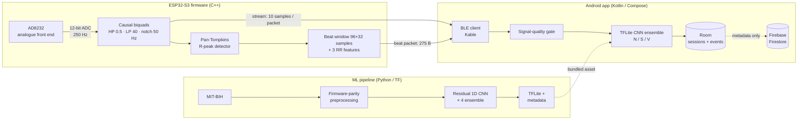

# Arrhythmia Detection System

[](https://github.com/Olivermoberg98/Arrhythmia-detection-system/actions/workflows/ci.yml)
[](LICENSE)

An end-to-end single-lead ECG arrhythmia monitor. The system has three parts:

- **ESP32-S3 firmware** that samples an AD8232 ECG front end, filters the signal and detects
  heartbeats in real time.
- **Android app** that receives the data over Bluetooth Low Energy and classifies every
  beat on the phone with TensorFlow Lite.
- **Python pipeline** that trains the classifier on the MIT-BIH Arrhythmia Database.

> [!WARNING]
> **Educational project, not a medical device.** It is not certified, validated or intended
> for diagnosis, monitoring or any clinical decision.

## How it works



1. The **firmware** reads the AD8232 at 250 Hz and filters it with fixed-coefficient biquads.
   It detects R-peaks, then sends two BLE notifications: a continuous waveform stream and,
   for each heartbeat, a 128-sample window aligned on the QRS together with RR-interval
   features.
2. The **app** checks each beat's signal quality and classifies it as Normal,
   Supraventricular or Ventricular ectopic. It shows the live ECG and heart rate, records
   sessions locally, and can export a PDF report. With consent, it syncs session
   *metadata* to Firestore. Raw waveforms never leave the phone.
3. The **pipeline** trains on MIT-BIH and reproduces the device's analogue and digital
   filter chain, so the model sees the same morphology the hardware produces.

## Results

The model was evaluated on the standard **inter-patient** MIT-BIH split (de Chazal et al.,
2004). Training and test beats come from different patients, which is harder and more
honest than a random beat-level split.

| Metric | Value |
|---|---|
| DS2 macro-F1, end-to-end (board + firmware filters → model) | **0.772** |
| DS2 macro-F1, training preprocessing path | 0.780 |
| Model | 4-member residual 1D CNN ensemble, ~700 KB INT8 TFLite |
| Firmware ↔ training parity | Beat windows match to ~1 µV; R-peaks agree on >99 % of beats |

| Class (training path) | Sensitivity | Positive predictivity | F1 |
|---|---|---|---|
| Normal | 0.986 | 0.963 | 0.974 |
| Supraventricular | **0.429** | 0.554 | 0.483 |
| Ventricular | 0.792 | 0.988 | 0.879 |

Supraventricular beats are the weak class. Three quarters of the test SVEBs come from a
single patient, and a patient-level bootstrap puts SVEB F1 anywhere between 0.11 and 0.54.
Per-patient and age/sex subgroup results, data provenance and the model change procedure
are in [MLD-001](docs/regulatory/MLD-001_MachineLearningDevelopment.md).

## Engineering highlights

- **Training reproduces the firmware, not the other way round.** Preprocessing models the
  AD8232 board's 2-pole analogue filters, resamples to 250 Hz and applies the firmware's
  exact causal biquads. Each annotated beat is then re-aligned on the same fiducial the
  on-device detector uses. Parity was verified by compiling the real `SignalProcessor.cpp`
  on the host and feeding it MIT-BIH.
- **RR features with real look-ahead.** The firmware holds each beat until the next R-peak,
  so `post_rr` is measured rather than guessed. This keeps the compensatory-pause cue that
  supraventricular beats depend on.
- **Variance-aware model selection.** Single training runs varied from 0.68 to 0.78
  macro-F1. Averaging four runs into one TFLite graph stabilises the result without tuning
  on the test set.
- **A robust live pipeline.** The firmware debounces lead-off, suppresses beats during
  settling and recovers a latched AD8232 via its SDN pin. The app uses bounded
  `SharedFlow`s with drop-oldest buffering, a per-beat signal-quality gate, input-drift
  monitoring, and crash-safe chunked recording.
- **Privacy by design.** Explicit consent gates every screen and an audit log records
  access. Only session metadata is synced to the cloud.
- **Regulatory-style documentation.** An IEC 62304 / ISO 14971 / GDPR / EU AI Act-inspired
  document set lives in [`docs/regulatory/`](docs/regulatory/): requirements, architecture,
  risk management, verification plan, traceability matrix, DPIA, and a machine-learning
  development file covering data governance, subgroup performance and model change
  control. Its [index](docs/regulatory/README.md) maps the set against a full MDR technical
  file and states what is out of scope, and why.

## Repository layout

| Path | Contents | Stack |
|---|---|---|
| [`arrhythmia_system_controller/`](arrhythmia_system_controller/) | ESP32-S3 firmware: sampling, filtering, R-peak detection, BLE GATT server; host unit tests; serial capture and offline validation tools | C++17, Arduino, FreeRTOS, NimBLE, PlatformIO |
| [`ecg_monitor_app/`](ecg_monitor_app/) | Android app: BLE client, TFLite inference, Room storage, Firebase sync, PDF export | Kotlin, Jetpack Compose, Room, Kable, TFLite |
| [`ml_pipeline/`](ml_pipeline/) | Data download, firmware-parity preprocessing, training, TFLite conversion ([README](ml_pipeline/README.md)) | Python 3.10, TensorFlow 2.15, WFDB |
| [`docs/regulatory/`](docs/regulatory/) | Requirements, architecture, risk, verification, data-protection and machine-learning documents | Markdown, CSV |

## Hardware

- ESP32-S3-N16R8 development board (camera-board variant), USB powered
- AD8232 single-lead ECG breakout (SparkFun SEN-12650-compatible, gain ≈ 1100, analogue
  band 0.48–41 Hz)
- 3 disposable Ag/AgCl electrodes

| ESP32-S3 pin | AD8232 |
|---|---|
| GPIO1 (ADC1_CH0) | OUTPUT |
| GPIO42 / GPIO41 | LO+ / LO− (lead-off detect) |
| GPIO21 | SDN (shutdown, used to recover a latched front end) |

**Electrode placement.** The model is trained on MIT-BIH's modified lead II (MLII), so the
electrodes must reproduce lead II:

- **RA** (−IN): under the right collarbone
- **LA** (+IN): lower-left ribcage at the anterior axillary line
- **RL** (reference): lower-right ribcage, mirroring LA

Lead colours vary between cable kits. Use the lead-off pins to identify each snap if yours
are not labelled. Use fresh pads and let them settle for 1–2 minutes before recording.

## Getting started

### Firmware

Requires [PlatformIO](https://platformio.org/).

```bash
cd arrhythmia_system_controller
pio run                                  # build (default env: esp32s3cam)
pio run -t upload --upload-port <PORT>   # flash; hold BOOT during upload on this board
pio device monitor -b 921600 --port <PORT>
pio test -e native                       # host unit tests for the signal chain (needs a host gcc)
```

To stream a per-sample CSV for `tools/data_capture/capture.py`, build with
`-DENABLE_SERIAL_STREAM=1`.

### Android app

Requires Android Studio (JDK 17, compileSdk 36, minSdk 26) and a phone with BLE.

1. Create a Firebase project with an Android app for package `com.ecgmonitor.app`, and enable
   Anonymous Auth and Firestore.
2. Place its `google-services.json` in `ecg_monitor_app/app/`. The file is gitignored.
3. Build and install:

```bash
cd ecg_monitor_app
./gradlew installDebug
./gradlew test detekt     # unit tests + static analysis
```

The app also includes two MIT-BIH demo records, so you can try classification without the
hardware.

### ML pipeline

See [`ml_pipeline/README.md`](ml_pipeline/README.md). The trained model is already bundled
with the app, so retraining is optional.

## Testing and CI

GitHub Actions runs these checks on every push and pull request:

- Firmware host unit tests and the ESP32-S3 build
- Android unit tests, detekt and the debug build
- A check that the model artifacts bundled in the app match the pipeline output and the
  firmware's constants

Room migration tests run on a device (`./gradlew connectedAndroidTest`).

## Limitations

- **ADC headroom.** The ADC saturates at about ±1.4 mV electrode-referred. Large QRS
  complexes can clip on the device, which does not happen in training.
- **Single lead, 3 classes.** Fusion, paced and unclassifiable beats are excluded from
  training and are not detected.
  Atrial fibrillation and other rhythm-level diagnoses are out of scope.
- **Small validation set.** Threshold tuning and checkpoint selection rely on 4 validation
  records. That is the reason for the ensemble, and it remains a source of uncertainty.
- **Unisolated, USB-powered hardware.** There is no galvanic isolation. While electrodes
  are attached, power the board only from a battery or through a USB isolator, never
  directly from a mains-powered PC or charger.

## Acknowledgements

Training data comes from the
[MIT-BIH Arrhythmia Database](https://physionet.org/content/mitdb/1.0.0/) (Moody & Mark,
2001), distributed by PhysioNet (Goldberger et al., 2000) under the Open Data Commons
Attribution License. The app's demo records are derived from records 100 and 203.

## License

Released under the [MIT License](LICENSE).
